# Game-Theoretic Analysis of Renewable Energy Trading Among Microgrids

*Report material produced from the MultiGrid simulator (v0.4.0). Every number below is read from files written by
`python -m microgrid.cli experiment all` and is reproducible with the commands in the appendix. All energy
profiles are synthetic and all tariffs are illustrative assumptions; the findings describe the behaviour of the
model, not of any real community or utility.*

## Abstract

We simulate four grid-connected solar microgrids over a synthetic 24-hour day and compare three ways of
organising local energy trade on identical, frozen energy profiles:

1. utility-only trading (the baseline),
2. a cooperative market that allocates energy by a welfare-maximising linear program and prices each trade by
   bilateral Nash bargaining, and
3. a competitive market in which sellers choose posted prices in a finite simultaneous game, with every
   reported pure Nash equilibrium verified by exhaustive enumeration of unilateral deviations.

**Results:**
- **Cooperative market.** On the reference day it lowers the community's net cost from INR 8,633.60 to INR 7,373.66 (−14.6%). This is the LP optimum (efficiency 1.000), with fairly even gains (Jain index 0.830).
- **Competitive market.** It reaches INR 7,771.52 (−10.0%, efficiency 0.684), and its gains are concentrated on the sellers (Jain 0.467).
- **Why competition falls short.** The whole gap comes from two midday hours in which supply exceeds demand and no pure equilibrium exists. In every hour that has an equilibrium, the competitive market trades the LP-optimal quantity.
- **Across ten synthetic days**, the cooperative gain is stable (INR 1,284.80 ± 30.72), while the competitive gain varies (INR 898.80 ± 124.02, efficiency 0.51–0.85), driven by 1–3 hours per day without a pure equilibrium.

## 1. Problem

Microgrids with rooftop solar have surplus energy around midday and deficits in the morning and evening. With
only a utility connection, they sell surplus at a low export price *a* and buy deficits at a higher retail
price *b*. Trading surplus directly between microgrids can capture part of the spread *b − a*.

The project asks:
- how much financial benefit local trading creates,
- how that benefit is distributed under cooperative bargaining,
- how selfish seller pricing changes outcomes,
- whether a reported competitive price profile really is a pure Nash equilibrium, and
- how fees, solar availability and market size change these outcomes.

## 2. Related work (background only)

The blueprint lists background sources:
- the U.S. Department of Energy overview of microgrid systems,
- Zhang et al. (2018) in *Applied Energy* and Paudel et al. (2019) in *IEEE Transactions on Industrial Electronics* on P2P energy trading in microgrids and prosumer communities,
- a 2019 *Energy Procedia* paper on game-theoretic P2P trading,
- the SciPy, CVXPY, Streamlit and pytest documentation, and
- the Ausgrid solar home dataset descriptions.

Their findings are **not** reproduced or tested here. They motivate the problem setting only. The empirical
results in section 6 come solely from this simulator and its synthetic data.

## 3. Model

The full notation is in `docs/model_specification.md`.

**Setting.** Four microgrids, 24 hourly intervals, kWh per interval, INR. There is no storage, no network
losses and no power-flow constraint. In each hour a microgrid has surplus `S = max(G − D, 0)` or deficit
`R = max(D − G, 0)`, never both.

**Signed costs.** The baseline cost is `C_base = b·R − a·S` (signed: negative = export income). Every
mechanism's trades go through one shared settlement:

```
B = R − P2P_in,  X = S − P2P_out,  C = b·B − a·X + payments − receipts + fees
```

Internal payments cancel, so the community gain equals `Σ q·(b − a − f_s − f_b)` over trades.

**Cooperative.**
- The LP maximises `Σ g·q` with `g = b − a − f_s − f_b > 0`, subject to seller-surplus and buyer-deficit limits.
- Prices come from bilateral Nash bargaining on each fixed quantity, with the grid as the disagreement point: `p* = (1 − α)(a + f_s) + α(b − f_b)`, with α = 0.5.
- This is an optimisation benchmark combined with bilateral bargaining. It is **not** a Nash equilibrium, and it is **not** multilateral bargaining.

**Competitive.**
- The players are the sellers. Each posts a price on a 0.5 INR/kWh grid within `[a + f_s, b − f_b)`.
- Buyers are non-strategic. In ID order, each takes the cheapest acceptable offers first, ties broken by seller ID.
- Seller utility is gain over exporting: `U_i = Σ_j (p_i − a − f_s)·q_ij`.
- A profile is a pure Nash equilibrium iff no seller can strictly gain by any unilateral price change. Every deviation in every profile is evaluated.
- When no pure equilibrium exists, the interval is reported as `NO_PURE_NE` and **no P2P trade is settled**.

## 4. Software and verification

**Package layout.** The Python package separates energy accounting, settlement, the three mechanisms, metrics
and the simulation controller. Only the Streamlit dashboard (`app.py`) and the figure script import plotting
libraries.

**Correctness gates (all executed; see the appendix):**
- **345 automated tests**, covering:
  - the blueprint golden fixture (baseline INR 230 → cooperative INR 80, gain 150, trades 15/5/10 kWh at INR 5.50)
  - fee fixtures (gain 90 with 60 in fees; no trade once fees ≥ 5)
  - energy and payment invariants
  - every bad-input case
  - an independent reference enumeration of the competitive game
  - solver-failure handling
  - dashboard behaviour
- **An independent export audit** (`scripts/audit_exports.py`, which does not import the package) re-derives every identity and every equilibrium label from the exported CSVs: 22 of 22 checks pass.

**Golden fixture, all three mechanisms.** Both markets move the same 30 kWh, but the distribution differs
sharply:

| | Baseline | Cooperative | Competitive |
|---|---|---|---|
| Community net cost (INR) | 230.00 | 80.00 | 80.00 |
| Price (INR/kWh) | – | 5.50 | 7.50 (unique pure NE of 100 profiles) |
| Gains MG1 / MG2 / MG3 / MG4 (INR) | 0 | 50 / 37.5 / 25 / 37.5 | 90 / 7.5 / 45 / 7.5 |
| Jain fairness | N/A | 0.947 | 0.549 |

## 5. Experiments

`docs/experiment_protocol.md` defines seven controlled experiments (E1–E7). Each varies one parameter family on
frozen profiles (or, for generator parameters, on profiles regenerated with only that parameter changed), runs
all three mechanisms on identical states, and saves each run's exact config.

## 6. Results

### E1 – Reference day (Figures 1–6)

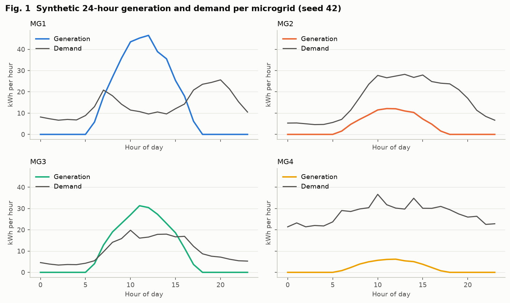
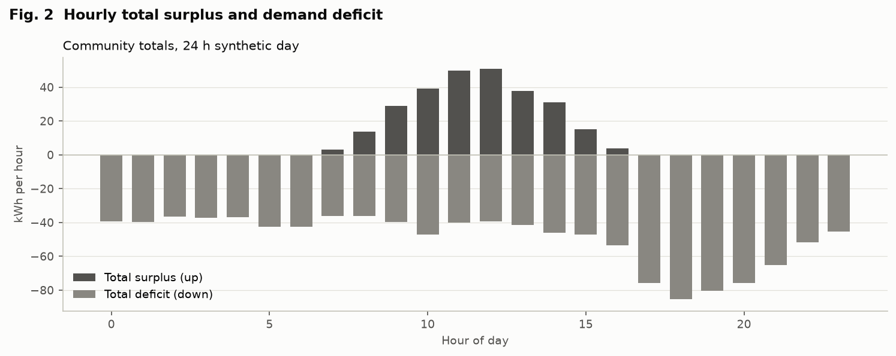

The synthetic day has surplus only between roughly 07:00 and 16:00 (Fig. 2). MG1 and MG3 are midday sellers;
MG2 and MG4 are buyers all day (Fig. 1).

| Mechanism | Net cost (INR) | Gain (INR) | Cost reduction | P2P volume (kWh) | Avg price (INR/kWh) | Jain | Efficiency |
|---|---|---|---|---|---|---|---|
| Baseline | 8,633.60 | 0.00 | 0.0% | 0.00 | N/A | N/A | 0.000 |
| Cooperative | 7,373.66 | 1,259.93 | 14.6% | 251.99 | 5.50 | 0.830 | 1.000 |
| Competitive | 7,771.52 | 862.08 | 10.0% | 172.42 | 7.50 | 0.467 | 0.684 |

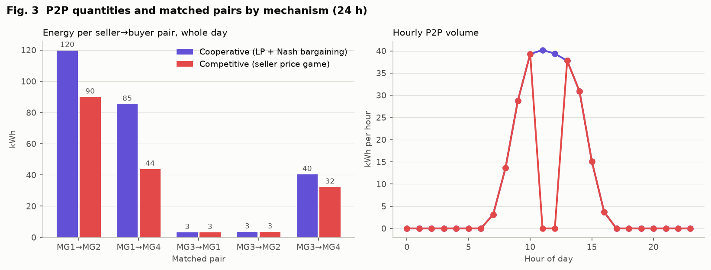
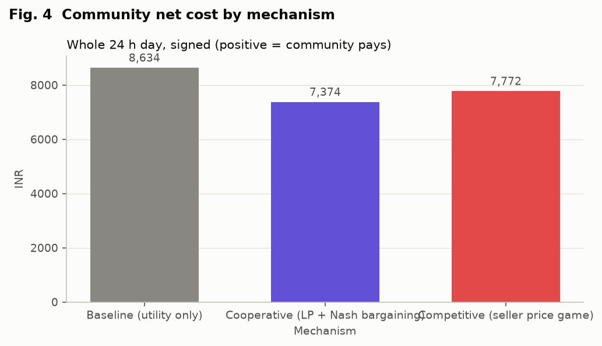
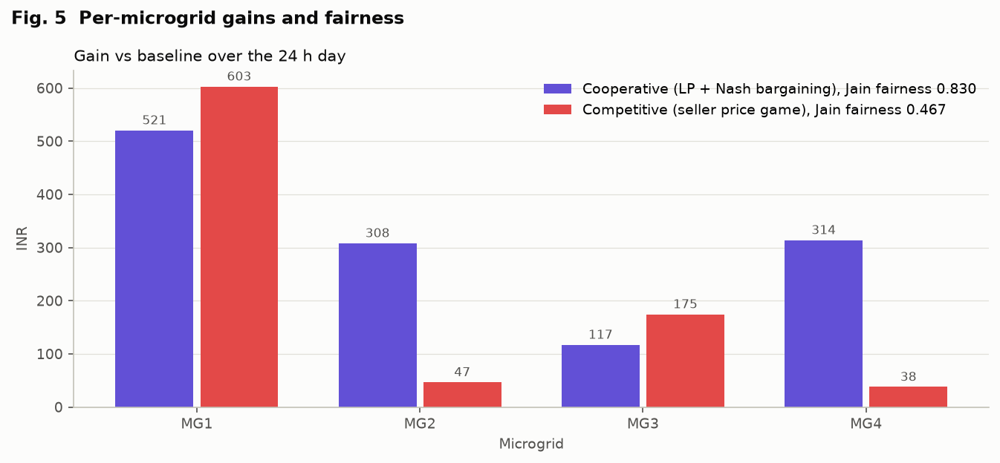

**Finding 1 – the competitive shortfall comes from two hours.**
- The competitive game has a unique, verified pure equilibrium in 8 trading hours, every one at the top tick of 7.50 INR/kWh. In those hours it trades exactly the LP-optimal volume (Fig. 3, right).
- In hours 11 and 12, total surplus exceeds total deficit. Capacity-constrained sellers then undercut each other in a cycle, and no pure equilibrium exists (Fig. 6, right: MG3, held at 6.50, would gain by moving to 7.00).
- With no P2P settlement in those two hours, competitive volume falls by 79.57 kWh, which is where the whole efficiency loss comes from.

**Finding 2 – competition shifts gains to sellers.** At the top-tick equilibria, buyers keep only
0.50 INR/kWh of the 5 INR/kWh spread. MG1 gains INR 602.90 under competition vs INR 520.54 under cooperation,
while the all-day buyers MG2 and MG4 gain INR 46.71 and 37.95 instead of 308.18 and 314.02 (Fig. 5).

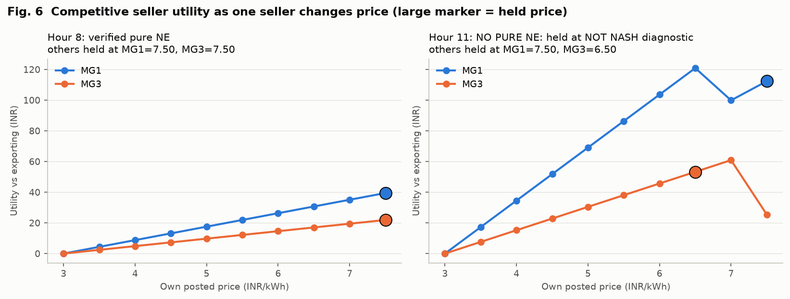

### E2 – Tariff spread (Figure 9)

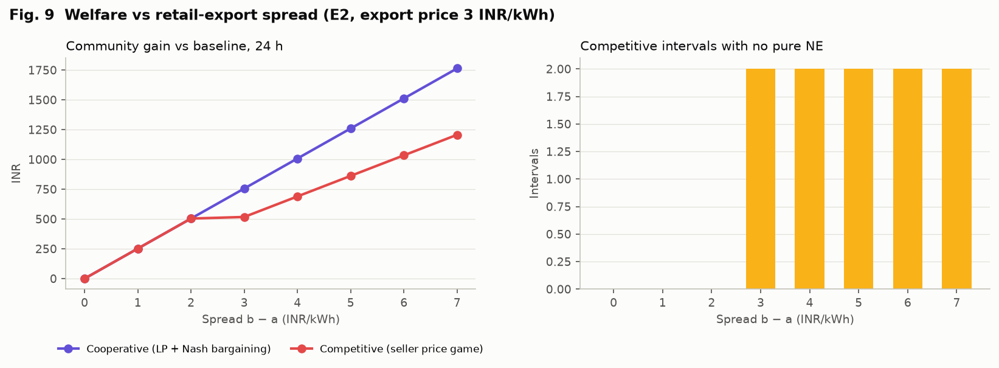

- **Cooperative gain** grows linearly with the spread: gain = spread × 251.99 kWh, from 0 at spread 0 to INR 1,763.91 at spread 7, because the optimal volume does not depend on prices.
- **Competitive market:**
  - At spreads of 1–2 INR/kWh it matches the cooperative gain exactly. The price grid has only 2–4 ticks, and every hour has a pure equilibrium.
  - From a spread of 3 upward, hours 11–12 lose their pure equilibrium and efficiency settles at 0.684.
- **Interpretation.** A wider spread gives sellers more room to undercut each other.

### E3 – Fee threshold (Figure 7)

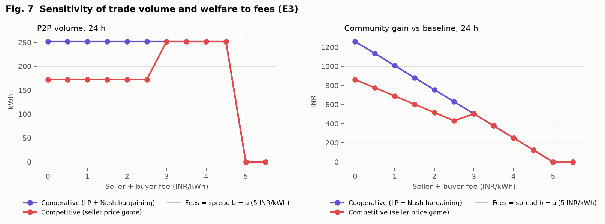

- **Cooperative gain** falls linearly with total fees, gain = (5 − fees) × 251.99 kWh, and reaches zero exactly when fees equal the 5 INR/kWh spread. Beyond that, no mechanism trades.
- **Finding 3 – fees can improve the competitive outcome.**
  - The competitive gain is not monotone in fees: it falls from INR 862.08 (no fees) to INR 431.04 at total fees of 2.5 INR/kWh, then *rises* to INR 503.97 at 3.0.
  - At fees ≥ 3, the individually rational price range narrows to four or fewer ticks, the hour 11–12 price war disappears, and the competitive market matches the cooperative gain until trading stops at 5.
  - This effect is a property of the discrete game and of the no-equilibrium settlement rule; it is not a general claim about real fees.

### E4 – Solar scale (Figure 10)

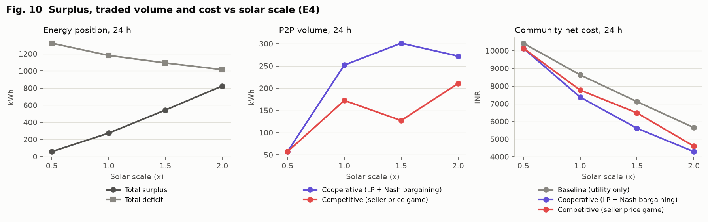

- **Energy position.** As solar output scales from 0.5× to 2.0×, total surplus rises from 57.24 to 824.19 kWh, total deficit falls from 1,324.42 to 1,015.59 kWh, and the baseline cost falls from INR 10,423.65 to INR 5,652.16.
- **Cooperative volume is not monotone:** 57.24 → 251.99 → 301.17 → 272.19 kWh. At 2.0× more hours have surplus exceeding deficit, so the per-hour limit min(S, R) binds on the deficit side.
- **Competitive efficiency:**

  | Solar scale | Efficiency | Hours with no pure NE |
  |---|---|---|
  | 0.5× | 1.000 | 0 |
  | 1.0× | 0.684 | 2 |
  | 1.5× | 0.422 | 5 |
  | 2.0× | 0.772 | 2 |

  More oversupplied hours mean more price wars.

### E5 – Market size (Figure 8)

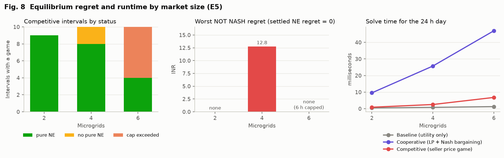

- **N = 2.**
  - Both markets reach the same gain (INR 622.88), and every hour has a pure equilibrium.
  - The cooperative Jain index of 1.000 is structural: with one buyer and one seller, every trade splits its surplus equally between the same two players.
  - The competitive index is 0.610.
- **N = 6.**
  - In six hours four sellers are active at once. That exceeds the default exact-enumeration cap of three sellers, so those hours are reported as `ENUMERATION_CAP_EXCEEDED` and not settled.
  - The competitive N = 6 total (INR 257.02, efficiency 0.175) is therefore **not** a market outcome and must not be compared with the cooperative INR 1,466.18.
  - Exact results would require raising the cap (10⁴ profiles per hour).
- **Runtime on the tested machine:**

  | Microgrids | Cooperative | Competitive | Baseline |
  |---|---|---|---|
  | 2 | 9.6 ms | 0.9 ms | ≤ 1.3 ms |
  | 4 | 25.7 ms | 2.5 ms | ≤ 1.3 ms |
  | 6 | 47.0 ms | 6.8 ms | ≤ 1.3 ms |

  The cooperative time is dominated by the extra tie-break LPs.

### E6 – Strategy resolution (Figure 11)

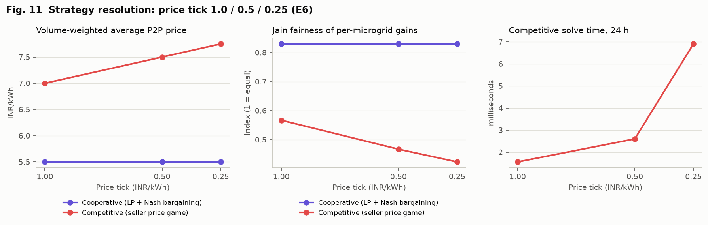

- **What changes with the price tick:** the price grid, and with it the top acceptable price. The average competitive price is 7.00, 7.50 and 7.75 INR/kWh for ticks of 1.0, 0.5 and 0.25.
- **The distribution follows:** competitive Jain fairness falls from 0.567 to 0.467 to 0.424.
- **What doesn't change:** total gain (INR 862.08) and the number of no-equilibrium hours (2).
- **Finding 4.** Finer price grids let sellers capture more of the spread without changing efficiency.

### E7 – Ten synthetic days (Figure 12)

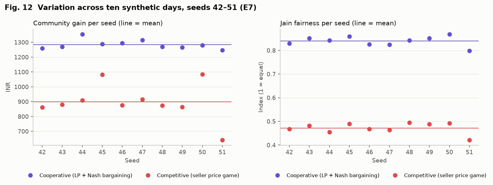

| Mechanism | Gain mean ± sd (INR) | Gain range (INR) | Jain mean ± sd | Efficiency mean ± sd (range) |
|---|---|---|---|---|
| Cooperative | 1,284.80 ± 30.72 | 1,248.22 – 1,353.45 | 0.839 ± 0.020 | 1.000 |
| Competitive | 898.80 ± 124.02 | 641.17 – 1,083.86 | 0.472 ± 0.023 | 0.699 ± 0.093 (0.514 – 0.846) |

Every seed has 1–3 hours without a pure equilibrium (mean 1.9). The seed-to-seed variation in competitive
gain is four times the cooperative variation, and it is driven by those hours.

## 7. Discussion

**Findings vs assumptions.** The findings in section 6 are properties of this model on synthetic data. Four
modelling assumptions shape them, and each is a choice rather than an observation:

- **(a) Buyer tie rule.** Buyers break price ties by seller ID. This is why, for example, identical sellers can have asymmetric equilibria.
- **(b) Discrete price grid.** Prices sit on a grid whose top tick is just below retail. This explains why every competitive equilibrium found sits at the top tick when demand is not oversupplied.
- **(c) Settlement without an equilibrium.** Intervals without a pure equilibrium are settled without P2P trade. Settling the NOT NASH diagnostic profile instead would raise competitive volume, but it would mix non-equilibrium outcomes into the totals.
- **(d) Bargaining weight.** α = 0.5 splits each cooperative trade's surplus equally. Any α in (0, 1) leaves the cooperative total unchanged and only moves the distribution.

**Main takeaways.** The cooperative benchmark reliably captures the full avoidable spread and distributes it
evenly. The competitive game matches its total exactly whenever a pure equilibrium exists, but:
- it transfers almost all of the gain to sellers, and
- it lacks pure equilibria precisely in the oversupplied midday hours where local trade matters most.

Higher P2P volume here is not a claim about renewable output or emissions.

## 8. Limitations

- Synthetic profiles and illustrative tariffs.
- No storage, losses, network constraints, forecasting or dispatch.
- Bilateral (not multilateral) bargaining.
- No mixed-strategy equilibria.
- Exact enumeration capped at three sellers by default.
- Buyers follow a fixed rule (not a Stackelberg equilibrium).
- Runtimes depend on the machine.

## 9. Conclusions and extensions

The simulator meets the blueprint's MVP:
- reproducible energy balance,
- payoff-based games with verified equilibria,
- tested settlement, and
- seven controlled experiments.

The extensions the blueprint suggests are:
- heterogeneous tariffs and pairwise fees,
- storage,
- forecast uncertainty,
- network-constrained power flow,
- multilateral bargaining or Shapley allocation, and
- learning or repeated-game agents.

Each would need updated equations, data contracts and test fixtures before its results could be compared with
these.

## Appendix – reproduction and environment

```bash
python -m pytest -q                                                   # 345 passed in 9.41 s (recorded run)
python -m microgrid.cli experiment all --out-dir results/experiments
python scripts/make_figures.py --results results/experiments --out docs/figures
python scripts/audit_exports.py results/experiments/E1                # 22 passed, 0 failed
```

Tested on macOS (Darwin 25.6.0, Apple silicon) with Python 3.13.9, numpy 2.5.4, pandas 2.3.3, scipy 1.18.1
(HiGHS), streamlit 1.66.1, plotly 6.9.0, matplotlib 3.11.2 and pytest 8.4.2. Each experiment folder's
`experiment.json` records the environment of its run.
